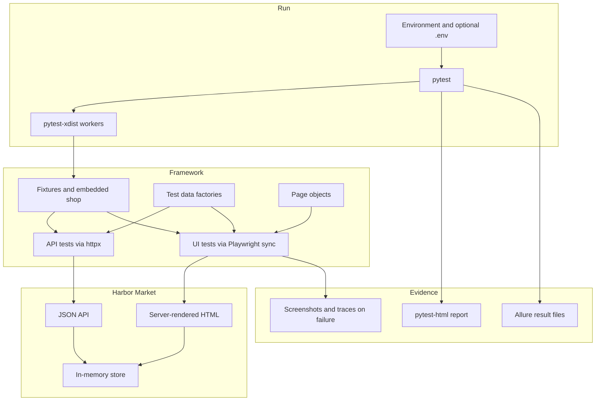

# Harbor Market QA

Portfolio project by Alexandru Cojocari, a junior Python / QA automation candidate.

Harbor Market is a small shop (sign in, catalog, cart, checkout) and the test framework that covers it. The shop is part of this repository, so the suite never calls an outside website. API tests use [httpx](https://www.python-httpx.org/). Browser tests use [Playwright](https://playwright.dev/python/)'s sync API and the Page Object Model. [pytest](https://docs.pytest.org/) runs both.

## Framework



| Layer | Where it lives | Role |
| --- | --- | --- |
| Shop under test | `demo_app/` | FastAPI, Jinja templates, session carts |
| Configuration | `qa_framework/settings.py` | Environment variables and `.env` |
| Process fixture | `qa_framework/server.py`, `tests/conftest.py` | Starts the shop on a free port, unless `BASE_URL` is set |
| Factories | `tests/factories.py` | Users, catalog ids, cart payloads, checkout forms |
| API tests | `tests/api/` | httpx against `/api/*` |
| Page objects | `tests/ui/pages/` | Browser actions. Assertions stay in the tests |
| UI tests | `tests/ui/` | Playwright sync API, Chromium by default |
| Reports | `reports/` (gitignored) | HTML report, Allure files, failure screenshots and traces |

Pytest markers are `smoke`, `regression`, `api`, and `ui`. Every test is `regression` plus either `api` or `ui`. Nine tests are also `smoke`.

## Quickstart

Python 3.12. From the repository root:

```bash
python3 -m venv .venv
source .venv/bin/activate
pip install -r requirements.txt
python -m playwright install --with-deps chromium
pytest -v
```

`make test` runs the same suite on two workers and writes `reports/report.html`. Other targets:

| Command | What it does |
| --- | --- |
| `make app` | Shop at http://127.0.0.1:8000, with `/docs` for the OpenAPI schema |
| `make test-api` | API tests only |
| `make test-ui` | Browser tests only |
| `make test-smoke` | The 9 smoke tests |
| `make test-parallel` | All tests, one worker per CPU |
| `make lint` | Ruff |
| `make docker-test` | Build the image and run the suite |

Sign in to the shop as `alex` / `demo123` (Alexandru Cojocari) or `guest` / `demo123` (Guest Shopper).

## Configuration

Copy `.env.example` to `.env` if you want local overrides. Variables already set in the shell win. Leave `BASE_URL` empty and pytest starts the shop itself.

| Variable | Default | Effect |
| --- | --- | --- |
| `BASE_URL` | empty | Shop to test. Empty starts an embedded server on a free port |
| `DEMO_USERNAME` | `alex` | Account the tests sign in as. Must already exist in the shop |
| `DEMO_PASSWORD` | `demo123` | Password for that account |
| `HEADLESS` | `true` | Set to `false` to show the browser. `--headed` also shows it |
| `BROWSER` | `chromium` | `chromium`, `firefox`, or `webkit` when the CLI does not pass `--browser` |
| `SLOW_MO` | `0` | Milliseconds of delay between Playwright actions |
| `ACTION_TIMEOUT_MS` | `15000` | Playwright timeout for actions and assertions |

`pytest.ini` turns on strict markers, screenshots on failure, and traces kept only for failures. Pass `--html=reports/report.html --self-contained-html` for the HTML report. Allure writes `reports/allure-results/` on every run.

A line quantity must be from 1 to 10, and it cannot pass the product's stock. The wool throw has 5 in stock, so 6 is rejected even though 6 is under the cap of 10.

## How to add a test

API, for a new cart rule:

1. Add a reusable payload to `tests/factories.py` when more than one test needs it.
2. Create the test in `tests/api/`. Use `api` for an anonymous client and `auth_api` for a fresh logged-in session.
3. Mark it `api` and `regression`. Add `smoke` only when the path is part of the short suite.

```python
@pytest.mark.regression
@pytest.mark.api
def test_cart_starts_empty(auth_api: httpx.Client) -> None:
    body = auth_api.get("/api/cart").json()
    assert body["item_count"] == 0
```

UI:

1. Put the interaction on the page object in `tests/ui/pages/`. Leave `expect(...)` in the test.
2. Prefer `get_by_test_id`. The shop exposes those hooks so a copy change does not have to break the suite, and so the test does not depend on CSS classes.
3. Mark the test `ui` and `regression`.

Run one test while you write it:

```bash
pytest tests/ui/test_cart.py::test_remove_item_shows_an_empty_cart -v
```

Point the suite at a shop you already started with `BASE_URL=http://127.0.0.1:8000 pytest -m smoke`.

## Test catalog

53 tests collected: 36 API, 17 UI. Nine of them are smoke. UI node ids end in `[chromium]` because Playwright parametrizes the browser.

| Area | Count | Cases |
| --- | --- | --- |
| Auth API | 8 | Valid login (smoke), wrong password, unknown user, blank fields, missing JSON fields (3), logout invalidates the token |
| Catalog API | 5 | Health (smoke), product list and prices (smoke), one product, unknown product, OpenAPI paths |
| Cart API | 13 | Auth required, add and total (smoke), quantity accumulates, max quantity 10, update, remove, unknown product, quantities 0 / -1 / 11, non-numeric quantity, over stock, two sessions do not share a cart |
| Checkout API | 10 | Place order (smoke), empty cart, four invalid emails (cart is kept), short name, order lookup, order hidden from the other customer, unknown order |
| Login UI | 6 | Valid login lands on the catalog (smoke), bad password, unknown user, blank form, logout, `/cart` redirects to login |
| Catalog UI | 4 | Seed products and prices (smoke), badge after add (smoke), quantity 2, add while signed out does not stick after login |
| Cart UI | 2 | Update recalculates the total, remove shows the empty state |
| Checkout UI | 5 | Lamp through to a placed order (smoke), bad email, short name, short address, empty cart hides the submit button |

Negative cases are the rejected logins, bad quantities, over-stock add, empty checkout, invalid shipping fields, and the order that the other customer must not see.

## Sample run

This is a real `pytest -v` run against the embedded shop. Timing will move a little between machines. The same 53 tests with `pytest -n 2` passed in 4.80s on this machine.

```text
============================= test session starts ==============================
platform linux -- Python 3.12.3, pytest-9.2.0, pluggy-1.7.0 -- /workspace/.venv/bin/python
cachedir: .pytest_cache
metadata: {'Python': '3.12.3', 'Platform': 'Linux-6.12.94+-x86_64-with-glibc2.39', 'Packages': {'pytest': '9.2.0', 'pluggy': '1.7.0'}, 'Plugins': {'html': '4.2.0', 'anyio': '4.16.0', 'allure-pytest': '2.16.2', 'playwright': '0.10.0', 'xdist': '3.8.0', 'metadata': '3.1.1'}}
rootdir: /workspace
configfile: pytest.ini
testpaths: tests
plugins: html-4.2.0, anyio-4.16.0, allure-pytest-2.16.2, playwright-0.10.0, xdist-3.8.0, metadata-3.1.1
collecting ... collected 53 items

tests/api/test_auth.py::test_login_success PASSED                        [  1%]
tests/api/test_auth.py::test_login_rejects_bad_password PASSED           [  3%]
tests/api/test_auth.py::test_login_rejects_unknown_user PASSED           [  5%]
tests/api/test_auth.py::test_login_rejects_blank_fields PASSED           [  7%]
tests/api/test_auth.py::test_login_missing_fields[missing-username] PASSED [  9%]
tests/api/test_auth.py::test_login_missing_fields[missing-password] PASSED [ 11%]
tests/api/test_auth.py::test_login_missing_fields[empty-body] PASSED     [ 13%]
tests/api/test_auth.py::test_logout_rejects_reused_token PASSED          [ 15%]
tests/api/test_cart.py::test_cart_requires_auth PASSED                   [ 16%]
tests/api/test_cart.py::test_add_lists_line_and_total PASSED             [ 18%]
tests/api/test_cart.py::test_adding_the_same_product_accumulates PASSED  [ 20%]
tests/api/test_cart.py::test_add_accepts_the_maximum_quantity PASSED     [ 22%]
tests/api/test_cart.py::test_update_quantity PASSED                      [ 24%]
tests/api/test_cart.py::test_remove_item PASSED                          [ 26%]
tests/api/test_cart.py::test_unknown_product_is_rejected PASSED          [ 28%]
tests/api/test_cart.py::test_invalid_quantity_is_rejected[0] PASSED      [ 30%]
tests/api/test_cart.py::test_invalid_quantity_is_rejected[-1] PASSED     [ 32%]
tests/api/test_cart.py::test_invalid_quantity_is_rejected[11] PASSED     [ 33%]
tests/api/test_cart.py::test_quantity_must_be_a_number PASSED            [ 35%]
tests/api/test_cart.py::test_quantity_above_stock_is_rejected PASSED     [ 37%]
tests/api/test_cart.py::test_sessions_do_not_share_carts PASSED          [ 39%]
tests/api/test_catalog.py::test_health PASSED                            [ 41%]
tests/api/test_catalog.py::test_list_products PASSED                     [ 43%]
tests/api/test_catalog.py::test_get_product PASSED                       [ 45%]
tests/api/test_catalog.py::test_unknown_product_is_not_found PASSED      [ 47%]
tests/api/test_catalog.py::test_openapi_lists_shop_routes PASSED         [ 49%]
tests/api/test_checkout.py::test_checkout_success PASSED                 [ 50%]
tests/api/test_checkout.py::test_checkout_empty_cart PASSED              [ 52%]
tests/api/test_checkout.py::test_checkout_rejects_invalid_email[missing-at] PASSED [ 54%]
tests/api/test_checkout.py::test_checkout_rejects_invalid_email[missing-domain] PASSED [ 56%]
tests/api/test_checkout.py::test_checkout_rejects_invalid_email[missing-dot] PASSED [ 58%]
tests/api/test_checkout.py::test_checkout_rejects_invalid_email[blank] PASSED [ 60%]
tests/api/test_checkout.py::test_checkout_rejects_a_short_name PASSED    [ 62%]
tests/api/test_checkout.py::test_order_lookup PASSED                     [ 64%]
tests/api/test_checkout.py::test_order_is_hidden_from_another_customer PASSED [ 66%]
tests/api/test_checkout.py::test_unknown_order_is_not_found PASSED       [ 67%]
tests/ui/test_cart.py::test_update_quantity_recalculates_the_total[chromium] PASSED [ 69%]
tests/ui/test_cart.py::test_remove_item_shows_an_empty_cart[chromium] PASSED [ 71%]
tests/ui/test_catalog.py::test_catalog_lists_seed_products[chromium] PASSED [ 73%]
tests/ui/test_catalog.py::test_add_to_cart_updates_the_badge[chromium] PASSED [ 75%]
tests/ui/test_catalog.py::test_add_to_cart_respects_the_quantity[chromium] PASSED [ 77%]
tests/ui/test_catalog.py::test_adding_without_a_session_asks_for_login[chromium] PASSED [ 79%]
tests/ui/test_checkout.py::test_checkout_happy_path[chromium] PASSED     [ 81%]
tests/ui/test_checkout.py::test_checkout_rejects_invalid_fields[chromium-bad-email] PASSED [ 83%]
tests/ui/test_checkout.py::test_checkout_rejects_invalid_fields[chromium-short-name] PASSED [ 84%]
tests/ui/test_checkout.py::test_checkout_rejects_invalid_fields[chromium-short-address] PASSED [ 86%]
tests/ui/test_checkout.py::test_checkout_empty_cart_is_blocked[chromium] PASSED [ 88%]
tests/ui/test_login.py::test_valid_login_lands_on_catalog[chromium] PASSED [ 90%]
tests/ui/test_login.py::test_invalid_login_shows_an_error[chromium-bad-password] PASSED [ 92%]
tests/ui/test_login.py::test_invalid_login_shows_an_error[chromium-unknown-user] PASSED [ 94%]
tests/ui/test_login.py::test_invalid_login_shows_an_error[chromium-blank] PASSED [ 96%]
tests/ui/test_login.py::test_logout_returns_to_login[chromium] PASSED    [ 98%]
tests/ui/test_login.py::test_cart_requires_login[chromium] PASSED        [100%]

============================== 53 passed in 6.51s ==============================
```

## Continuous integration

`.github/workflows/ci.yml` runs on pull requests and on pushes to `main`. The job installs the Python dependencies, installs Chromium with its system libraries, lints with Ruff, runs the API suite and the UI suite on two workers each, and uploads `reports/` as the `test-reports` artifact. The UI suite still runs when the API suite fails, and the job fails if either suite failed.

## Docker

The image is `mcr.microsoft.com/playwright/python:v1.64.1-noble`, pinned to the same Playwright version as `requirements.txt`.

```bash
docker build -t harbor-qa .
docker run --rm -v "$PWD/reports:/work/reports" harbor-qa
```

To serve the shop from that image instead of running tests:

```bash
docker run --rm -p 8000:8000 harbor-qa \
  python -m uvicorn demo_app.main:app --host 0.0.0.0 --port 8000
```

## Limitations

- The store is in memory. A restart drops every cart and order. Do not start uvicorn with more than one worker; workers would not share that memory.
- A cart hangs off the session token, not the user account. Logging in again starts an empty cart, and logout throws the old one away.
- The two passwords are hard-coded and stored in plain text. There is no hashing, CSRF protection, rate limit, or payment. Checkout marks an order `placed` and stops there.
- `DEMO_USERNAME` and `DEMO_PASSWORD` choose which built-in account the tests use. They do not create users. The accounts are `alex` and `guest`.
- CI installs Chromium only. Firefox and WebKit run locally with `--browser` once those browsers are installed.
- Failure screenshots are embedded in the pytest-html report and also saved under `reports/screenshots/`. Playwright keeps a trace zip for failed UI tests under `reports/playwright/`. Passing tests drop both.
- CI uploads the pytest-html files. Allure output is the raw result directory. Building the Allure website needs the Allure command line, which is not part of CI.
- pytest-xdist gives each worker its own shop process and browser. That keeps workers from colliding. It does not show how one shared deployment behaves under parallel customers, apart from the session-isolation test.
- There is no screenshot baseline and no accessibility audit. The pages have labels, a skip link, and landmarks. That is the extent of the accessibility work.
- `data-testid` hooks will not catch a redesign that keeps the hooks and breaks the layout.
- The suite stays off the network on purpose. It says nothing about third-party scripts or a production catalog.

## License

MIT. See [LICENSE](LICENSE). Copyright 2026 Alexandru Cojocari.
